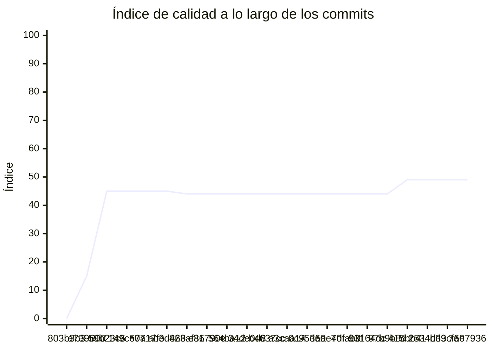

<!-- evaluacion:inicio -->
# Evaluación — pr2-camus/tp-turnos-reservas

> Documento **generado automáticamente** por la cátedra de Programación II (UM): RepoSense + análisis de calidad de **7 dimensiones**. **No editar a mano**: se regenera en cada evaluación.
> Rama evaluada: `main`. Análisis **heurístico** (regex + métricas) + build: es una criba para orientar la revisión, **no una nota**. La **documentación** del repositorio no se evalúa.
> Generado: 2026-11-18.

## 1. Veredicto

| Aspecto | Resultado |
|---|---|
| Índice de calidad | **58/100** |
| Tipo de repositorio | `backend` |
| Build (`mvnw verify` / `gradlew check`) | OK |
| Código (LOC) | 10,662 |
| Archivos de código | 228 |
| Clases | 202 |
| Código dentro de clases (%POO) | 75% |
| Funciones fuera de clases | 0 |
| Duplicación (puerta) | 9.2% |
| Duplicación lógica | 9.8% |
| Duplicación de boilerplate | 3.3% |
| Cobertura | 63% |
| Tope duro aplicado a D1 | `POO_BAJO` → D1 ≤ 60 |

> Este informe **describe** lo que el análisis midió con los criterios ya establecidos de la materia. No es una nota.

## 2. Semáforo de aprobación

Criterios de la cátedra (`CRITERIOS-CALIDAD.md`): **Aprobar** se juega con el perfil `estandar`; **destacar**, con el `exigente` (meta de excelencia).

| Semáforo | Resultado |
|---|---|
| Aprobar (`estandar`) | **no cumple** — 4/11 |
| Destacar (`exigente`) | **no cumple** — 3/11 |

**Para aprobar, falta cumplir:** SOLID; Hexagonal; Duplicación; Cobertura

**Para destacar, falta cumplir:** SOLID; POO; Hexagonal; Duplicación; Cobertura

## 3. Autoría (RepoSense)

| Autor | Commits | Código (LOC) | Tests (LOC) | Docs (LOC) | Días activos | % del código |
|---|---:|---:|---:|---:|---:|---:|
| zoecamus | 1 | 0 | 0 | 0 | 10 | 0% |

> _El LOC de autoría lo calcula RepoSense sobre el historial y puede diferir del LOC de código del análisis (que mira el estado de `main`)._

## 4. Dimensiones evaluadas

Cada dimensión indica **qué mide**, **por qué importa** y **tu resultado**. Cuando el puntaje queda por debajo de la referencia, se agregan preguntas para **investigar la causa** (no hay recetas).

| Dimensión | Peso | Puntaje |
|:--|--:|--:|
| **D1** Diseño OO, SOLID y patrones (20%) | 20% | 2 |
| **D2** Arquitectura hexagonal — backend (15%) | 15% | 0 |
| **D3** Frontend KMP: MVVM y buenas prácticas (10%) | 10% | N/A |
| **D4** Integración y contrato (10%) | 10% | 90 |
| **D5** Seguridad y robustez (10%) | 10% | 100 |
| **D6** Pruebas y cobertura (20%) | 20% | 91 |
| **D7** Proceso y entrega (15%) | 15% | 100 |

### D1. Diseño OO, SOLID y patrones (20%)

- **Qué mide:** Métricas orientadas a objetos (clases, métodos, campos, cohesión, acoplamiento, herencia) y proxies de SOLID, más patrones de diseño.
- **Por qué importa:** El eje de la materia es el buen uso de la POO y su arquitectura: un diseño con clases claras y poco acopladas es más fácil de entender, probar y cambiar.
- **Tu resultado:** **2/100**
- **Para investigar la causa:**
    - ¿Se pensó el modelo de clases antes de codificar o se agrupó después?
    - ¿Qué clases concentran muchas responsabilidades a la vez?
    - ¿Los colaboradores llegan como parámetros o se crean por dentro?

### D2. Arquitectura hexagonal — backend (15%)

- **Qué mide:** Separación en capas (dominio, puertos de entrada/salida, adaptadores) y dirección de las dependencias del backend.
- **Por qué importa:** Aislar el dominio de la infraestructura permite cambiar la base de datos, el framework o el transporte sin tocar las reglas de negocio.
- **Tu resultado:** **0/100**
- **Para investigar la causa:**
    - ¿El dominio importa framework o detalles de persistencia?
    - ¿Dónde vive la lógica de negocio frente a los controladores?
    - ¿Se definieron puertos para los servicios que se consumen?

### D4. Integración y contrato (10%)

- **Qué mide:** Cumplimiento del contrato de integración de la cátedra (formato de errores, paginación, autenticación, endpoints esperados).
- **Por qué importa:** Los servicios deben poder integrarse entre sí y con la app sin sorpresas; el contrato es lo que hacen cumplir las pruebas de integración.
- **Tu resultado:** **90/100**

### D5. Seguridad y robustez (10%)

- **Qué mide:** Credenciales embebidas, consultas SQL por concatenación, y presencia de config de entorno; aislamiento de secretos.
- **Por qué importa:** Un secreto en el repositorio o una consulta construida por concatenación son riesgos concretos, no hipotéticos.
- **Tu resultado:** **100/100**

### D6. Pruebas y cobertura (20%)

- **Qué mide:** Cantidad y resultado de pruebas y cobertura de línea (JaCoCo/Kover, Surefire/Failsafe) cuando hay build.
- **Por qué importa:** Las pruebas son la red de seguridad para refactorizar e integrar; la cobertura acota las zonas sin verificar.
- **Tu resultado:** **91/100**

### D7. Proceso y entrega (15%)

- **Qué mide:** Artefactos verificables de proceso/entrega: `compose`, `.env.example`, CI (`.github/workflows/`), `CODEOWNERS` y wrapper de build (`mvnw`/`gradlew`). **No** puntúa documentación.
- **Por qué importa:** Un proyecto que compila, se levanta y se valida solo es más fácil de revisar y de integrar en equipo.
- **Tu resultado:** **100/100**

## 5. Señales detectadas

El análisis encontró las siguientes señales, con el archivo y la línea donde se originan cuando están disponibles:

**Archivos con más señales**

| Archivo | Señales |
|---|---:|
| `src/main/java/ar/edu/um/prog2/camus/turnos/domain/User.java` | 11 |
| `src/main/java/ar/edu/um/prog2/camus/turnos/web/rest/errors/ExceptionTranslator.java` | 11 |
| `src/main/java/ar/edu/um/prog2/camus/turnos/domain/AbstractAuditingEntity.java` | 10 |
| `src/main/java/ar/edu/um/prog2/camus/turnos/availability/infrastructure/client/CatalogRestAdapter.java` | 7 |
| `src/main/java/ar/edu/um/prog2/camus/turnos/domain/Authority.java` | 7 |
| `src/main/java/ar/edu/um/prog2/camus/turnos/service/UserService.java` | 6 |
| `src/main/java/ar/edu/um/prog2/camus/turnos/reservation/domain/model/ReservationProcess.java` | 5 |
| `src/main/java/ar/edu/um/prog2/camus/turnos/security/SecurityUtils.java` | 4 |
| `src/main/java/ar/edu/um/prog2/camus/turnos/reservation/infrastructure/client/CatedraHoldRestAdapter.java` | 4 |
| `src/main/java/ar/edu/um/prog2/camus/turnos/reservation/application/usecases/RecoverPendingReservationsUseCaseImpl.java` | 4 |

**DIP/concretos** (57)
- clase 'TurnosApp' muy acoplada (CBO=24) — `src/main/java/ar/edu/um/prog2/camus/turnos/TurnosApp.java:24`
- clase 'LoggingAspect' muy acoplada (CBO=24) — `src/main/java/ar/edu/um/prog2/camus/turnos/aop/logging/LoggingAspect.java:22`
- clase 'AvailabilityService' muy acoplada (CBO=8) — `src/main/java/ar/edu/um/prog2/camus/turnos/availability/application/service/AvailabilityService.java:12`
- clase 'GetAvailabilityUseCaseImpl' muy acoplada (CBO=9) — `src/main/java/ar/edu/um/prog2/camus/turnos/availability/application/usecases/GetAvailabilityUseCaseImpl.java:20`
- clase 'CatalogRestAdapter' muy acoplada (CBO=24) — `src/main/java/ar/edu/um/prog2/camus/turnos/availability/infrastructure/client/CatalogRestAdapter.java:26`
- clase 'CatalogRestAdapter' instancia 5 concretos (CBO=24) — `src/main/java/ar/edu/um/prog2/camus/turnos/availability/infrastructure/client/CatalogRestAdapter.java:26`
- clase 'CatedraOccupancyRestAdapter' muy acoplada (CBO=18) — `src/main/java/ar/edu/um/prog2/camus/turnos/availability/infrastructure/client/CatedraOccupancyRestAdapter.java:21`
- clase 'CatedraOccupancyRestAdapter' instancia 3 concretos (CBO=18) — `src/main/java/ar/edu/um/prog2/camus/turnos/availability/infrastructure/client/CatedraOccupancyRestAdapter.java:21`
- clase 'AvailabilityController' muy acoplada (CBO=8) — `src/main/java/ar/edu/um/prog2/camus/turnos/availability/infrastructure/web/controller/AvailabilityController.java:17`
- clase 'AsyncConfiguration' muy acoplada (CBO=12) — `src/main/java/ar/edu/um/prog2/camus/turnos/config/AsyncConfiguration.java:22`
- clase 'AsyncConfiguration' instancia 3 concretos (CBO=12) — `src/main/java/ar/edu/um/prog2/camus/turnos/config/AsyncConfiguration.java:22`
- clase 'CRLFLogConverter' muy acoplada (CBO=16) — `src/main/java/ar/edu/um/prog2/camus/turnos/config/CRLFLogConverter.java:23`
- clase 'LiquibaseConfiguration' muy acoplada (CBO=18) — `src/main/java/ar/edu/um/prog2/camus/turnos/config/LiquibaseConfiguration.java:22`
- clase 'SecurityConfiguration' muy acoplada (CBO=14) — `src/main/java/ar/edu/um/prog2/camus/turnos/config/SecurityConfiguration.java:21`
- clase 'SecurityJwtConfiguration' muy acoplada (CBO=19) — `src/main/java/ar/edu/um/prog2/camus/turnos/config/SecurityJwtConfiguration.java:21`
- clase 'WebConfigurer' muy acoplada (CBO=13) — `src/main/java/ar/edu/um/prog2/camus/turnos/config/WebConfigurer.java:21`
- clase 'User' muy acoplada (CBO=12) — `src/main/java/ar/edu/um/prog2/camus/turnos/domain/User.java:24`
- clase 'ReservationService' muy acoplada (CBO=13) — `src/main/java/ar/edu/um/prog2/camus/turnos/reservation/application/service/ReservationService.java:17`
- clase 'CancelReservationUseCaseImpl' muy acoplada (CBO=21) — `src/main/java/ar/edu/um/prog2/camus/turnos/reservation/application/usecases/CancelReservationUseCaseImpl.java:15`
- clase 'ProcessReservationEventUseCaseImpl' muy acoplada (CBO=20) — `src/main/java/ar/edu/um/prog2/camus/turnos/reservation/application/usecases/ProcessReservationEventUseCaseImpl.java:16`
- clase 'RecoverPendingReservationsUseCaseImpl' muy acoplada (CBO=31) — `src/main/java/ar/edu/um/prog2/camus/turnos/reservation/application/usecases/RecoverPendingReservationsUseCaseImpl.java:23`
- clase 'StartReservationUseCaseImpl' muy acoplada (CBO=31) — `src/main/java/ar/edu/um/prog2/camus/turnos/reservation/application/usecases/StartReservationUseCaseImpl.java:21`
- clase 'StartReservationUseCaseImpl' instancia 4 concretos (CBO=31) — `src/main/java/ar/edu/um/prog2/camus/turnos/reservation/application/usecases/StartReservationUseCaseImpl.java:21`
- clase 'SubmitPhoneUseCaseImpl' muy acoplada (CBO=26) — `src/main/java/ar/edu/um/prog2/camus/turnos/reservation/application/usecases/SubmitPhoneUseCaseImpl.java:18`
- clase 'SubmitPhoneUseCaseImpl' instancia 5 concretos (CBO=26) — `src/main/java/ar/edu/um/prog2/camus/turnos/reservation/application/usecases/SubmitPhoneUseCaseImpl.java:18`
- clase 'ReservationProcess' muy acoplada (CBO=13) — `src/main/java/ar/edu/um/prog2/camus/turnos/reservation/domain/model/ReservationProcess.java:10`
- clase 'ReservationStatus' muy acoplada (CBO=11) — `src/main/java/ar/edu/um/prog2/camus/turnos/reservation/domain/model/ReservationStatus.java:6`
- clase 'HoldClient' muy acoplada (CBO=9) — `src/main/java/ar/edu/um/prog2/camus/turnos/reservation/domain/ports/out/HoldClient.java:8`
- clase 'CatedraHoldRestAdapter' muy acoplada (CBO=30) — `src/main/java/ar/edu/um/prog2/camus/turnos/reservation/infrastructure/client/CatedraHoldRestAdapter.java:23`
- clase 'CatedraHoldRestAdapter' instancia 8 concretos (CBO=30) — `src/main/java/ar/edu/um/prog2/camus/turnos/reservation/infrastructure/client/CatedraHoldRestAdapter.java:23`
- clase 'CatedraReservationsRestAdapter' muy acoplada (CBO=12) — `src/main/java/ar/edu/um/prog2/camus/turnos/reservation/infrastructure/client/CatedraReservationsRestAdapter.java:20`
- clase 'KafkaPhoneSubmissionPublisher' muy acoplada (CBO=22) — `src/main/java/ar/edu/um/prog2/camus/turnos/reservation/infrastructure/messaging/KafkaPhoneSubmissionPublisher.java:22`
- clase 'ReservationActionsListener' muy acoplada (CBO=24) — `src/main/java/ar/edu/um/prog2/camus/turnos/reservation/infrastructure/messaging/ReservationActionsListener.java:17`
- clase 'ReservationProcessEntity' muy acoplada (CBO=9) — `src/main/java/ar/edu/um/prog2/camus/turnos/reservation/infrastructure/persistence/entity/ReservationProcessEntity.java:19`
- clase 'ReservationRecoveryScheduler' muy acoplada (CBO=8) — `src/main/java/ar/edu/um/prog2/camus/turnos/reservation/infrastructure/scheduling/ReservationRecoveryScheduler.java:14`
- clase 'JhipsterCurrentUserAdapter' muy acoplada (CBO=10) — `src/main/java/ar/edu/um/prog2/camus/turnos/reservation/infrastructure/user/JhipsterCurrentUserAdapter.java:13`
- clase 'ReservationController' muy acoplada (CBO=11) — `src/main/java/ar/edu/um/prog2/camus/turnos/reservation/infrastructure/web/controller/ReservationController.java:23`
- clase 'DomainUserDetailsService' muy acoplada (CBO=16) — `src/main/java/ar/edu/um/prog2/camus/turnos/security/DomainUserDetailsService.java:22`
- clase 'DomainUserDetailsService' instancia 5 concretos (CBO=16) — `src/main/java/ar/edu/um/prog2/camus/turnos/security/DomainUserDetailsService.java:22`
- clase 'SecurityUtils' muy acoplada (CBO=17) — `src/main/java/ar/edu/um/prog2/camus/turnos/security/SecurityUtils.java:19`
- clase 'MailService' muy acoplada (CBO=21) — `src/main/java/ar/edu/um/prog2/camus/turnos/service/MailService.java:26`
- clase 'UserService' muy acoplada (CBO=36) — `src/main/java/ar/edu/um/prog2/camus/turnos/service/UserService.java:31`
- clase 'UserService' instancia 5 concretos (CBO=36) — `src/main/java/ar/edu/um/prog2/camus/turnos/service/UserService.java:31`
- clase 'AdminUserDTO' muy acoplada (CBO=8) — `src/main/java/ar/edu/um/prog2/camus/turnos/service/dto/AdminUserDTO.java:16`
- clase 'RestClientsConfig' muy acoplada (CBO=10) — `src/main/java/ar/edu/um/prog2/camus/turnos/shared/infrastructure/config/RestClientsConfig.java:16`
- clase 'Retry' muy acoplada (CBO=14) — `src/main/java/ar/edu/um/prog2/camus/turnos/shared/infrastructure/retry/Retry.java:15`
- clase 'AccountResource' muy acoplada (CBO=39) — `src/main/java/ar/edu/um/prog2/camus/turnos/web/rest/AccountResource.java:31`
- clase 'AccountResource' instancia 9 concretos (CBO=39) — `src/main/java/ar/edu/um/prog2/camus/turnos/web/rest/AccountResource.java:31`
- clase 'AuthenticateController' muy acoplada (CBO=33) — `src/main/java/ar/edu/um/prog2/camus/turnos/web/rest/AuthenticateController.java:37`
- clase 'AuthenticateController' instancia 3 concretos (CBO=33) — `src/main/java/ar/edu/um/prog2/camus/turnos/web/rest/AuthenticateController.java:37`
- clase 'AuthorityResource' muy acoplada (CBO=26) — `src/main/java/ar/edu/um/prog2/camus/turnos/web/rest/AuthorityResource.java:27`
- clase 'PublicUserResource' muy acoplada (CBO=18) — `src/main/java/ar/edu/um/prog2/camus/turnos/web/rest/PublicUserResource.java:20`
- clase 'UserResource' muy acoplada (CBO=46) — `src/main/java/ar/edu/um/prog2/camus/turnos/web/rest/UserResource.java:60`
- clase 'UserResource' instancia 6 concretos (CBO=46) — `src/main/java/ar/edu/um/prog2/camus/turnos/web/rest/UserResource.java:60`
- clase 'BadRequestAlertException' muy acoplada (CBO=8) — `src/main/java/ar/edu/um/prog2/camus/turnos/web/rest/errors/BadRequestAlertException.java:11`
- clase 'ExceptionTranslator' muy acoplada (CBO=79) — `src/main/java/ar/edu/um/prog2/camus/turnos/web/rest/errors/ExceptionTranslator.java:51`
- clase 'ExceptionTranslator' instancia 4 concretos (CBO=79) — `src/main/java/ar/edu/um/prog2/camus/turnos/web/rest/errors/ExceptionTranslator.java:51`

**SRP/responsabilidad** (70)
- método 'TurnosApp.logApplicationStartup' de 35 líneas — `src/main/java/ar/edu/um/prog2/camus/turnos/TurnosApp.java:74`
- clase 'LoggingAspect' grande (LOC=100, métodos=15, campos=1) — `src/main/java/ar/edu/um/prog2/camus/turnos/aop/logging/LoggingAspect.java:22`
- método 'GetAvailabilityUseCaseImpl.getAvailability' de 31 líneas — `src/main/java/ar/edu/um/prog2/camus/turnos/availability/application/usecases/GetAvailabilityUseCaseImpl.java:31`
- método 'Professional.Professional' con 5 parámetros — `src/main/java/ar/edu/um/prog2/camus/turnos/availability/domain/model/Professional.java:3`
- método 'WeeklySchedule.WeeklySchedule' con 7 parámetros — `src/main/java/ar/edu/um/prog2/camus/turnos/availability/domain/model/WeeklySchedule.java:6`
- método 'CatalogRestAdapter.ProfessionalDto' con 5 parámetros — `src/main/java/ar/edu/um/prog2/camus/turnos/availability/infrastructure/client/CatalogRestAdapter.java:84`
- método 'ProfessionalDto.ProfessionalDto' con 5 parámetros — `src/main/java/ar/edu/um/prog2/camus/turnos/availability/infrastructure/client/CatalogRestAdapter.java:84`
- método 'CatalogRestAdapter.ScheduleDto' con 7 parámetros — `src/main/java/ar/edu/um/prog2/camus/turnos/availability/infrastructure/client/CatalogRestAdapter.java:87`
- método 'ScheduleDto.ScheduleDto' con 7 parámetros — `src/main/java/ar/edu/um/prog2/camus/turnos/availability/infrastructure/client/CatalogRestAdapter.java:87`
- método 'LiquibaseConfiguration.liquibase' de 50 líneas — `src/main/java/ar/edu/um/prog2/camus/turnos/config/LiquibaseConfiguration.java:33`
- método 'SecurityConfiguration.filterChain' de 30 líneas — `src/main/java/ar/edu/um/prog2/camus/turnos/config/SecurityConfiguration.java:35`
- clase 'AbstractAuditingEntity' con baja cohesión (14%) — `src/main/java/ar/edu/um/prog2/camus/turnos/domain/AbstractAuditingEntity.java:23`
- clase 'Authority' grande (LOC=64, métodos=10, campos=3) — `src/main/java/ar/edu/um/prog2/camus/turnos/domain/Authority.java:18`
- clase 'Authority' con baja cohesión (24%) — `src/main/java/ar/edu/um/prog2/camus/turnos/domain/Authority.java:18`
- clase 'User' grande (LOC=165, métodos=29, campos=14) — `src/main/java/ar/edu/um/prog2/camus/turnos/domain/User.java:24`
- clase 'User' con baja cohesión (8%) — `src/main/java/ar/edu/um/prog2/camus/turnos/domain/User.java:24`
- clase 'SecurityMetersService' grande (LOC=35, métodos=6, campos=8) — `src/main/java/ar/edu/um/prog2/camus/turnos/management/SecurityMetersService.java:8`
- clase 'SecurityMetersService' con baja cohesión (27%) — `src/main/java/ar/edu/um/prog2/camus/turnos/management/SecurityMetersService.java:8`
- clase 'ReservationService' con baja cohesión (33%) — `src/main/java/ar/edu/um/prog2/camus/turnos/reservation/application/service/ReservationService.java:17`
- método 'ReservationService.ReservationService' con 5 parámetros — `src/main/java/ar/edu/um/prog2/camus/turnos/reservation/application/service/ReservationService.java:25`
- método 'ProcessReservationEventUseCaseImpl.process' con complejidad 9 — `src/main/java/ar/edu/um/prog2/camus/turnos/reservation/application/usecases/ProcessReservationEventUseCaseImpl.java:30`
- método 'RecoverPendingReservationsUseCaseImpl.recover' de 33 líneas — `src/main/java/ar/edu/um/prog2/camus/turnos/reservation/application/usecases/RecoverPendingReservationsUseCaseImpl.java:43`
- método 'RecoverPendingReservationsUseCaseImpl.recover' con complejidad 8 — `src/main/java/ar/edu/um/prog2/camus/turnos/reservation/application/usecases/RecoverPendingReservationsUseCaseImpl.java:43`
- método 'RecoverPendingReservationsUseCaseImpl.reconcile' con complejidad 9 — `src/main/java/ar/edu/um/prog2/camus/turnos/reservation/application/usecases/RecoverPendingReservationsUseCaseImpl.java:93`
- método 'StartReservationUseCaseImpl.startReservation' de 41 líneas — `src/main/java/ar/edu/um/prog2/camus/turnos/reservation/application/usecases/StartReservationUseCaseImpl.java:41`
- método 'StartReservationUseCaseImpl.startReservation' con complejidad 7 — `src/main/java/ar/edu/um/prog2/camus/turnos/reservation/application/usecases/StartReservationUseCaseImpl.java:41`
- método 'SubmitPhoneUseCaseImpl.submitPhone' de 44 líneas — `src/main/java/ar/edu/um/prog2/camus/turnos/reservation/application/usecases/SubmitPhoneUseCaseImpl.java:35`
- método 'PhoneSubmission.PhoneSubmission' con 6 parámetros — `src/main/java/ar/edu/um/prog2/camus/turnos/reservation/domain/model/PhoneSubmission.java:5`
- clase 'ReservationProcess' grande (LOC=102, métodos=17, campos=10) — `src/main/java/ar/edu/um/prog2/camus/turnos/reservation/domain/model/ReservationProcess.java:10`
- clase 'ReservationProcess' con baja cohesión (25%) — `src/main/java/ar/edu/um/prog2/camus/turnos/reservation/domain/model/ReservationProcess.java:10`
- método 'ReservationProcess.ReservationProcess' con 7 parámetros — `src/main/java/ar/edu/um/prog2/camus/turnos/reservation/domain/model/ReservationProcess.java:23`
- método 'ReservationProcess.restore' con 10 parámetros — `src/main/java/ar/edu/um/prog2/camus/turnos/reservation/domain/model/ReservationProcess.java:43`
- método 'ReservationStatus.allowedNext' con complejidad 6 — `src/main/java/ar/edu/um/prog2/camus/turnos/reservation/domain/model/ReservationStatus.java:17`
- clase 'CatedraHoldRestAdapter' grande (LOC=96, métodos=14, campos=2) — `src/main/java/ar/edu/um/prog2/camus/turnos/reservation/infrastructure/client/CatedraHoldRestAdapter.java:23`
- clase 'CatedraReservationsRestAdapter' con baja cohesión (33%) — `src/main/java/ar/edu/um/prog2/camus/turnos/reservation/infrastructure/client/CatedraReservationsRestAdapter.java:20`
- método 'CatedraReservationsRestAdapter.listReservations' con complejidad 6 — `src/main/java/ar/edu/um/prog2/camus/turnos/reservation/infrastructure/client/CatedraReservationsRestAdapter.java:34`
- clase 'ReservationActionsListener' con baja cohesión (17%) — `src/main/java/ar/edu/um/prog2/camus/turnos/reservation/infrastructure/messaging/ReservationActionsListener.java:17`
- método 'ReservationActionsListener.toType' con complejidad 8 — `src/main/java/ar/edu/um/prog2/camus/turnos/reservation/infrastructure/messaging/ReservationActionsListener.java:57`
- clase 'ReservationProcessEntity' grande (LOC=85, métodos=20, campos=10) — `src/main/java/ar/edu/um/prog2/camus/turnos/reservation/infrastructure/persistence/entity/ReservationProcessEntity.java:19`
- clase 'ReservationProcessEntity' con baja cohesión (5%) — `src/main/java/ar/edu/um/prog2/camus/turnos/reservation/infrastructure/persistence/entity/ReservationProcessEntity.java:19`
- método 'ReservationProcessResponse.ReservationProcessResponse' con 6 parámetros — `src/main/java/ar/edu/um/prog2/camus/turnos/reservation/infrastructure/web/dto/ReservationProcessResponse.java:3`
- clase 'DomainUserDetailsService' con baja cohesión (7%) — `src/main/java/ar/edu/um/prog2/camus/turnos/security/DomainUserDetailsService.java:22`
- clase 'SecurityUtils' grande (LOC=97, métodos=11, campos=3) — `src/main/java/ar/edu/um/prog2/camus/turnos/security/SecurityUtils.java:19`
- clase 'SecurityUtils' con baja cohesión (0%) — `src/main/java/ar/edu/um/prog2/camus/turnos/security/SecurityUtils.java:19`
- clase 'MailService' con baja cohesión (43%) — `src/main/java/ar/edu/um/prog2/camus/turnos/service/MailService.java:26`
- método 'MailService.sendEmail' con 5 parámetros — `src/main/java/ar/edu/um/prog2/camus/turnos/service/MailService.java:55`
- método 'MailService.sendEmailSync' con 5 parámetros — `src/main/java/ar/edu/um/prog2/camus/turnos/service/MailService.java:59`
- clase 'UserService' grande (LOC=235, métodos=29, campos=4) — `src/main/java/ar/edu/um/prog2/camus/turnos/service/UserService.java:31`
- método 'UserService.registerUser' de 34 líneas — `src/main/java/ar/edu/um/prog2/camus/turnos/service/UserService.java:82`
- método 'UserService.createUser' de 33 líneas — `src/main/java/ar/edu/um/prog2/camus/turnos/service/UserService.java:126`
- método 'UserService.updateUser' con 5 parámetros — `src/main/java/ar/edu/um/prog2/camus/turnos/service/UserService.java:212`
- clase 'AdminUserDTO' grande (LOC=140, métodos=29, campos=14) — `src/main/java/ar/edu/um/prog2/camus/turnos/service/dto/AdminUserDTO.java:16`
- clase 'AdminUserDTO' con baja cohesión (16%) — `src/main/java/ar/edu/um/prog2/camus/turnos/service/dto/AdminUserDTO.java:16`
- clase 'PasswordChangeDTO' con baja cohesión (40%) — `src/main/java/ar/edu/um/prog2/camus/turnos/service/dto/PasswordChangeDTO.java:9`
- clase 'UserDTO' con baja cohesión (31%) — `src/main/java/ar/edu/um/prog2/camus/turnos/service/dto/UserDTO.java:11`
- clase 'UserMapper' grande (LOC=112, métodos=14, campos=0) — `src/main/java/ar/edu/um/prog2/camus/turnos/service/mapper/UserMapper.java:21`
- método 'Retry.withBackoff' con complejidad 6 — `src/main/java/ar/edu/um/prog2/camus/turnos/shared/infrastructure/retry/Retry.java:21`
- clase 'AccountResource' grande (LOC=156, métodos=10, campos=5) — `src/main/java/ar/edu/um/prog2/camus/turnos/web/rest/AccountResource.java:31`
- clase 'AuthenticateController' con baja cohesión (24%) — `src/main/java/ar/edu/um/prog2/camus/turnos/web/rest/AuthenticateController.java:37`
- clase 'ErrorConstants' grande (LOC=11, métodos=1, campos=8) — `src/main/java/ar/edu/um/prog2/camus/turnos/web/rest/errors/ErrorConstants.java:5`
- clase 'ExceptionTranslator' grande (LOC=228, métodos=26, campos=8) — `src/main/java/ar/edu/um/prog2/camus/turnos/web/rest/errors/ExceptionTranslator.java:51`
- clase 'ExceptionTranslator' con baja cohesión (1%) — `src/main/java/ar/edu/um/prog2/camus/turnos/web/rest/errors/ExceptionTranslator.java:51`
- método 'ExceptionTranslator.handleExceptionInternal' con 5 parámetros — `src/main/java/ar/edu/um/prog2/camus/turnos/web/rest/errors/ExceptionTranslator.java:80`
- método 'ExceptionTranslator.customizeProblem' de 30 líneas — `src/main/java/ar/edu/um/prog2/camus/turnos/web/rest/errors/ExceptionTranslator.java:118`
- método 'ExceptionTranslator.customizeProblem' con complejidad 10 — `src/main/java/ar/edu/um/prog2/camus/turnos/web/rest/errors/ExceptionTranslator.java:118`
- método 'ExceptionTranslator.getCustomizedErrorDetails' con complejidad 6 — `src/main/java/ar/edu/um/prog2/camus/turnos/web/rest/errors/ExceptionTranslator.java:228`
- método 'ExceptionTranslator.getMappedStatus' con complejidad 6 — `src/main/java/ar/edu/um/prog2/camus/turnos/web/rest/errors/ExceptionTranslator.java:238`
- método 'ExceptionTranslator.resolveCode' con complejidad 13 — `src/main/java/ar/edu/um/prog2/camus/turnos/web/rest/errors/ExceptionTranslator.java:293`
- clase 'LoginVM' con baja cohesión (33%) — `src/main/java/ar/edu/um/prog2/camus/turnos/web/rest/vm/LoginVM.java:9`
- clase 'ManagedUserVM' con baja cohesión (17%) — `src/main/java/ar/edu/um/prog2/camus/turnos/web/rest/vm/ManagedUserVM.java:9`

**OCP/type-switch** (8)
- clase 'CatalogRestAdapter' con 1 type-checks — `src/main/java/ar/edu/um/prog2/camus/turnos/availability/infrastructure/client/CatalogRestAdapter.java:26`
- clase 'Authority' con 1 type-checks — `src/main/java/ar/edu/um/prog2/camus/turnos/domain/Authority.java:18`
- clase 'User' con 1 type-checks — `src/main/java/ar/edu/um/prog2/camus/turnos/domain/User.java:24`
- clase 'CatedraHoldRestAdapter' con 1 type-checks — `src/main/java/ar/edu/um/prog2/camus/turnos/reservation/infrastructure/client/CatedraHoldRestAdapter.java:23`
- clase 'SecurityUtils' con 7 type-checks — `src/main/java/ar/edu/um/prog2/camus/turnos/security/SecurityUtils.java:19`
- clase 'Retry' con 2 type-checks — `src/main/java/ar/edu/um/prog2/camus/turnos/shared/infrastructure/retry/Retry.java:15`
- clase 'AuthenticateController' con 1 type-checks — `src/main/java/ar/edu/um/prog2/camus/turnos/web/rest/AuthenticateController.java:37`
- clase 'ExceptionTranslator' con 29 type-checks — `src/main/java/ar/edu/um/prog2/camus/turnos/web/rest/errors/ExceptionTranslator.java:51`

**POO** (2)
- clase 'SecurityMetersService' con 4 campos públicos (encapsulación) — `src/main/java/ar/edu/um/prog2/camus/turnos/management/SecurityMetersService.java:8`
- clase 'ErrorConstants' con 8 campos públicos (encapsulación) — `src/main/java/ar/edu/um/prog2/camus/turnos/web/rest/errors/ErrorConstants.java:5`

**?** (2)
- clase 'EmailAlreadyUsedException' con herencia profunda (DIT=2) — `src/main/java/ar/edu/um/prog2/camus/turnos/web/rest/errors/EmailAlreadyUsedException.java:6`
- clase 'LoginAlreadyUsedException' con herencia profunda (DIT=2) — `src/main/java/ar/edu/um/prog2/camus/turnos/web/rest/errors/LoginAlreadyUsedException.java:6`

**duplicación** (6)
- duplicación lógica: 9.2% · boilerplate: 3.3%
- bloque de 8 líneas repetido 4 veces en src/main/java/ar/edu/um/prog2/camus/turnos/web/rest/UserResource.java:63, src/main/java/ar/edu/um/prog2/camus/turnos/web/rest/UserResource.java:64, src/main/java/ar/edu/um/prog2/camus/turnos/web/rest/UserResource.java:65 — `src/main/java/ar/edu/um/prog2/camus/turnos/web/rest/UserResource.java:63`
- bloque de 8 líneas repetido 4 veces en src/test/java/ar/edu/um/prog2/camus/turnos/web/rest/AccountResourceIT.java:413, src/test/java/ar/edu/um/prog2/camus/turnos/web/rest/AccountResourceIT.java:452, src/test/java/ar/edu/um/prog2/camus/turnos/web/rest/AccountResourceIT.java:490 — `src/test/java/ar/edu/um/prog2/camus/turnos/web/rest/AccountResourceIT.java:413`
- bloque de 8 líneas repetido 4 veces en src/test/java/ar/edu/um/prog2/camus/turnos/web/rest/AccountResourceIT.java:414, src/test/java/ar/edu/um/prog2/camus/turnos/web/rest/AccountResourceIT.java:453, src/test/java/ar/edu/um/prog2/camus/turnos/web/rest/AccountResourceIT.java:491 — `src/test/java/ar/edu/um/prog2/camus/turnos/web/rest/AccountResourceIT.java:414`
- bloque de 8 líneas repetido 4 veces en src/test/java/ar/edu/um/prog2/camus/turnos/web/rest/AccountResourceIT.java:415, src/test/java/ar/edu/um/prog2/camus/turnos/web/rest/AccountResourceIT.java:454, src/test/java/ar/edu/um/prog2/camus/turnos/web/rest/AccountResourceIT.java:492 — `src/test/java/ar/edu/um/prog2/camus/turnos/web/rest/AccountResourceIT.java:415`
- bloque de 8 líneas repetido 4 veces en src/test/java/ar/edu/um/prog2/camus/turnos/web/rest/AccountResourceIT.java:416, src/test/java/ar/edu/um/prog2/camus/turnos/web/rest/AccountResourceIT.java:455, src/test/java/ar/edu/um/prog2/camus/turnos/web/rest/AccountResourceIT.java:493 — `src/test/java/ar/edu/um/prog2/camus/turnos/web/rest/AccountResourceIT.java:416`

**hexagonal** (20)
- domain importa framework/infra: import com.fasterxml.jackson.annotation.JsonIgnoreProperties; — `src/main/java/ar/edu/um/prog2/camus/turnos/domain/AbstractAuditingEntity.java:3`
- domain importa framework/infra: import jakarta.persistence.Column; — `src/main/java/ar/edu/um/prog2/camus/turnos/domain/AbstractAuditingEntity.java:4`
- domain importa framework/infra: import jakarta.persistence.EntityListeners; — `src/main/java/ar/edu/um/prog2/camus/turnos/domain/AbstractAuditingEntity.java:5`
- domain importa framework/infra: import jakarta.persistence.MappedSuperclass; — `src/main/java/ar/edu/um/prog2/camus/turnos/domain/AbstractAuditingEntity.java:6`
- domain importa framework/infra: import org.springframework.data.annotation.CreatedBy; — `src/main/java/ar/edu/um/prog2/camus/turnos/domain/AbstractAuditingEntity.java:10`
- domain importa framework/infra: import org.springframework.data.annotation.CreatedDate; — `src/main/java/ar/edu/um/prog2/camus/turnos/domain/AbstractAuditingEntity.java:11`
- domain importa framework/infra: import org.springframework.data.annotation.LastModifiedBy; — `src/main/java/ar/edu/um/prog2/camus/turnos/domain/AbstractAuditingEntity.java:12`
- domain importa framework/infra: import org.springframework.data.annotation.LastModifiedDate; — `src/main/java/ar/edu/um/prog2/camus/turnos/domain/AbstractAuditingEntity.java:13`
- domain importa framework/infra: import org.springframework.data.jpa.domain.support.AuditingEntityListener; — `src/main/java/ar/edu/um/prog2/camus/turnos/domain/AbstractAuditingEntity.java:14`
- domain importa framework/infra: import com.fasterxml.jackson.annotation.JsonIgnoreProperties; — `src/main/java/ar/edu/um/prog2/camus/turnos/domain/Authority.java:3`
- domain importa framework/infra: import jakarta.persistence.*; — `src/main/java/ar/edu/um/prog2/camus/turnos/domain/Authority.java:4`
- domain importa framework/infra: import jakarta.validation.constraints.*; — `src/main/java/ar/edu/um/prog2/camus/turnos/domain/Authority.java:5`
- domain importa framework/infra: import org.springframework.data.domain.Persistable; — `src/main/java/ar/edu/um/prog2/camus/turnos/domain/Authority.java:9`
- domain importa framework/infra: import com.fasterxml.jackson.annotation.JsonIgnore; — `src/main/java/ar/edu/um/prog2/camus/turnos/domain/User.java:4`
- domain importa framework/infra: import jakarta.persistence.*; — `src/main/java/ar/edu/um/prog2/camus/turnos/domain/User.java:5`
- domain importa framework/infra: import jakarta.validation.constraints.Email; — `src/main/java/ar/edu/um/prog2/camus/turnos/domain/User.java:6`
- domain importa framework/infra: import jakarta.validation.constraints.NotNull; — `src/main/java/ar/edu/um/prog2/camus/turnos/domain/User.java:7`
- domain importa framework/infra: import jakarta.validation.constraints.Pattern; — `src/main/java/ar/edu/um/prog2/camus/turnos/domain/User.java:8`
- domain importa framework/infra: import jakarta.validation.constraints.Size; — `src/main/java/ar/edu/um/prog2/camus/turnos/domain/User.java:9`
- domain importa framework/infra: import org.hibernate.annotations.BatchSize; — `src/main/java/ar/edu/um/prog2/camus/turnos/domain/User.java:17`

## 6. Evolución por commit

Métricas calculadas sobre el estado de `main` en **cada commit** (21 commits con trabajo), del primero al último. La calidad usa el perfil `exigente`; el aporte de código lo mide RepoSense. El índice puede **bajar** al crecer el proyecto: se acumulan señales.

| # | Fecha | Commit | Autor | LOC | Índice | %POO | Duplic. | Sueltas |
|---|---|---|---|---:|---:|---:|---:|---:|
| 1 | 2026-09-21 | `803b3b3` | zoecamus | 0 | 0 | 0% | 0.0% | 0 |
| 2 | 2026-09-22 | `a739600` | Ing. Daniel Quinteros | 0 | 15 | 0% | 0.0% | 0 |
| 3 | 2026-10-30 | `59b23c6` | zoecamus | 6,752 | 45 | 78% | 13.4% | 0 |
| 4 | 2026-10-31 | `149c677` | zoecamus | 6,940 | 45 | 76% | 13.2% | 0 |
| 5 | 2026-11-01 | `e0a17fe` | zoecamus | 6,937 | 45 | 76% | 13.2% | 0 |
| 6 | 2026-11-02 | `ab3d868` | zoecamus | 6,947 | 45 | 76% | 13.2% | 0 |
| 7 | 2026-11-02 | `423af86` | zoecamus | 7,225 | 44 | 75% | 12.7% | 0 |
| 8 | 2026-11-03 | `e31790e` | zoecamus | 7,454 | 44 | 75% | 12.3% | 0 |
| 9 | 2026-11-09 | `564ba12` | zoecamus | 7,643 | 44 | 75% | 11.9% | 0 |
| 10 | 2026-11-09 | `34de0d8` | zoecamus | 8,345 | 44 | 75% | 11.6% | 0 |
| 11 | 2026-11-09 | `b4637cc` | zoecamus | 8,731 | 44 | 75% | 11.3% | 0 |
| 12 | 2026-11-11 | `a3caa14` | zoecamus | 9,247 | 44 | 75% | 10.7% | 0 |
| 13 | 2026-11-11 | `0c95d60` | zoecamus | 9,247 | 44 | 75% | 10.7% | 0 |
| 14 | 2026-11-11 | `3aae4df` | zoecamus | 9,255 | 44 | 75% | 10.7% | 0 |
| 15 | 2026-11-11 | `70fab8f` | zoecamus | 9,569 | 44 | 75% | 10.3% | 0 |
| 16 | 2026-11-12 | `93164dc` | zoecamus | 10,110 | 44 | 75% | 9.7% | 0 |
| 17 | 2026-11-12 | `97b9b8d` | zoecamus | 10,304 | 44 | 75% | 9.5% | 0 |
| 18 | 2026-11-12 | `415bb41` | zoecamus | 10,304 | 49 | 75% | 9.5% | 0 |
| 19 | 2026-11-12 | `2534bd9` | zoecamus | 10,304 | 49 | 75% | 9.5% | 0 |
| 20 | 2026-11-12 | `d33cfae` | zoecamus | 10,601 | 49 | 75% | 9.3% | 0 |
| 21 | 2026-11-14 | `7607936` | zoecamus | 10,662 | 49 | 75% | 9.2% | 0 |

---
_Informe generado por la cátedra. Las dimensiones y umbrales corresponden a `calidad.py` (perfil `exigente`); el semáforo, a `CRITERIOS-CALIDAD.md`. La documentación del repositorio no se evalúa. Ante dudas, revisá el archivo señalado._
<!-- evaluacion:fin -->
