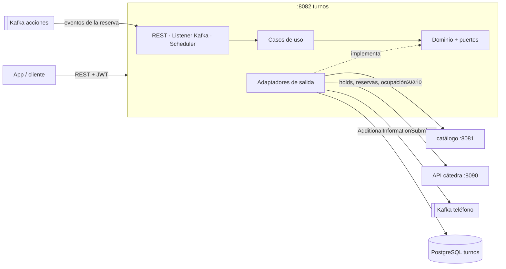

# Arquitectura (turnos)

Servicio de **turnos** (puerto 8082): muestra la disponibilidad de un profesional y gestiona el proceso de reserva de un turno contra la cátedra. Arquitectura hexagonal con dos agregados: `availability` y `reservation` (más `user`, de JHipster).

## Capas

| Capa | Contenido |
|---|---|
| `domain/model` | `ReservationProcess` (con la regla de transiciones), `ReservationStatus`, `Slot`, `WeeklySchedule` |
| `domain/ports/in` | un puerto por caso de uso (`StartReservationUseCase`, `SubmitPhoneUseCase`, …) |
| `domain/ports/out` | `HoldClient`, `CatalogClient`, `OccupancyClient`, `CatedraReservationsClient`, `PhoneSubmissionPublisher`, `ReservationProcessRepository`, `ProcessedEventRepository`, `CurrentUserProvider` |
| `application/usecases` | `*UseCaseImpl` |
| `infrastructure/client`, `messaging`, `scheduling`, `persistence`, `web` | adaptadores |

`TechnicalStructureTest` (ArchUnit) verifica las dependencias entre capas.

## Decisiones

- **El estado vive en el dominio**: `ReservationStatus.canTransitionTo` decide qué cambios son válidos; los casos de uso no repiten esa regla.
- **Puertos por capacidad**: separar `HoldClient` (acciones con efecto) de `CatedraReservationsClient` (lectura) permite reintentar solo lo seguro.
- **Cliente HTTP con timeouts** configurables (`RestClientsConfig`) para no colgarse si la cátedra no contesta.
- **Disponibilidad calculada**: se cruza la agenda del catálogo con las ocupaciones de la cátedra (`GetAvailabilityUseCaseImpl`).
