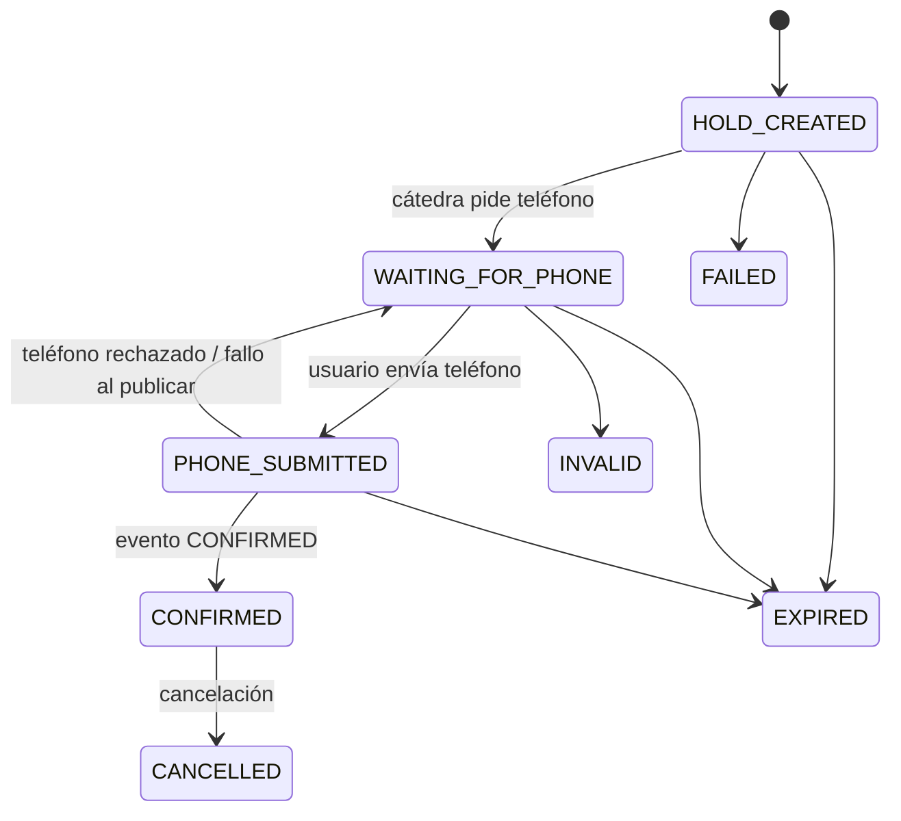

# Idempotencia y recuperación (turnos)

## Máquina de estados

Los estados finales son `EXPIRED`, `FAILED`, `INVALID` y `CANCELLED`. El hold dura unos 10 minutos (`expiresAt`).

## Idempotencia

- **Eventos Kafka**: `ProcessReservationEventUseCaseImpl` registra el `eventId` en `processed_event` dentro de la misma transacción que el cambio de estado (`registerIfNew`). Un duplicado se ignora y se loguea.
- **Eventos fuera de orden**: un evento sobre un estado final, o una transición inválida, se ignora sin error; no reabre un proceso cerrado.
- **Cancelar dos veces** devuelve la reserva ya cancelada (no falla).
- **Evento desconocido**: si el `reservationProcessId` no existe, se descarta con aviso.
- **Carreras**: antes de guardar, `StartReservation` y `Cancel` vuelven a leer el proceso, porque el listener puede haberlo actualizado en el medio.
- **Teléfono**: se guarda `PHONE_SUBMITTED` *antes* de publicar, así el listener ya ve el estado correcto si la cátedra responde rápido; si publicar falla se vuelve a `WAITING_FOR_PHONE` y el usuario puede reintentar.

## Fallos de la cátedra

| Situación | Qué hace turnos |
|---|---|
| `confirm` rechazado (4xx) | cierra el proceso (`EXPIRED` si `HOLD_EXPIRED`, si no `FAILED`) |
| `confirm` sin respuesta (timeout/caída) | **no** cierra: no se sabe qué pasó; lo resuelve la recuperación |
| Falla `cancel` | la reserva sigue `CONFIRMED`; se puede reintentar |
| Kafka caído al enviar teléfono | `503 KAFKA_UNAVAILABLE`, estado vuelve a `WAITING_FOR_PHONE` |

Solo se reintentan **lecturas** (`Retry.withBackoff`, 3 intentos, espera que se duplica, solo fallos transitorios: sin respuesta, 5xx o 429). Crear, confirmar y cancelar no se reintentan solos para no duplicar efectos.

## Recuperación (`RecoverPendingReservationsUseCaseImpl`)

Corre **al arrancar** y luego cada `reservation.recovery.interval-ms` (60 s). Toma los procesos abiertos y:

1. Pide a la cátedra el estado de sus reservas.
2. **Primero reconcilia**: si la cátedra dice `CONFIRMED`, avanza el proceso local hasta `CONFIRMED`; `CANCELLED` lo cancela; `FAILED` lo marca `EXPIRED` (si ya venció) o `FAILED`.
3. **Después vence** los procesos cuyo `expiresAt` pasó.
4. Si la cátedra no responde, no vence los `PHONE_SUBMITTED`, porque podrían estar confirmados en la cátedra y se perdió el evento.

Así, un evento perdido o un reinicio en medio del proceso no deja reservas colgadas ni vence una reserva confirmada. El consumidor Kafka usa confirmación manual: el mensaje solo se confirma si se procesó bien.
