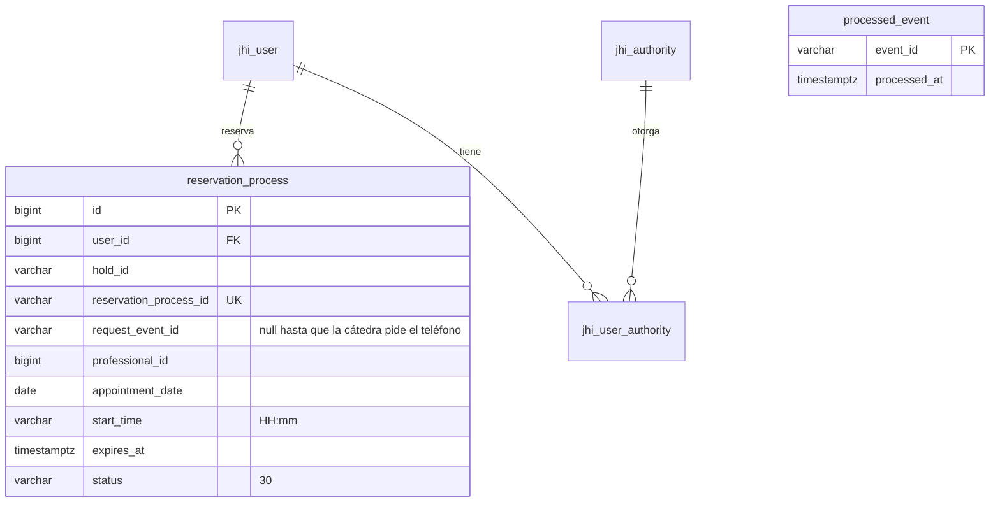

# Modelo de datos (turnos)

Liquibase (`config/liquibase/master.xml`): esquema inicial de JHipster, `password_hash_argon2`, `reservation_process`, `start_time_texto`, `processed_event`.

- `reservation_process_id` es único: lo asigna la cátedra y es la clave con la que llegan los eventos.
- `status` se guarda como texto (`ReservationStatus`).
- `start_time` es texto `HH:mm` para evitar problemas de zona horaria con el horario del turno.
- `password_hash` admite 255 caracteres porque Argon2id es más largo que BCrypt.
